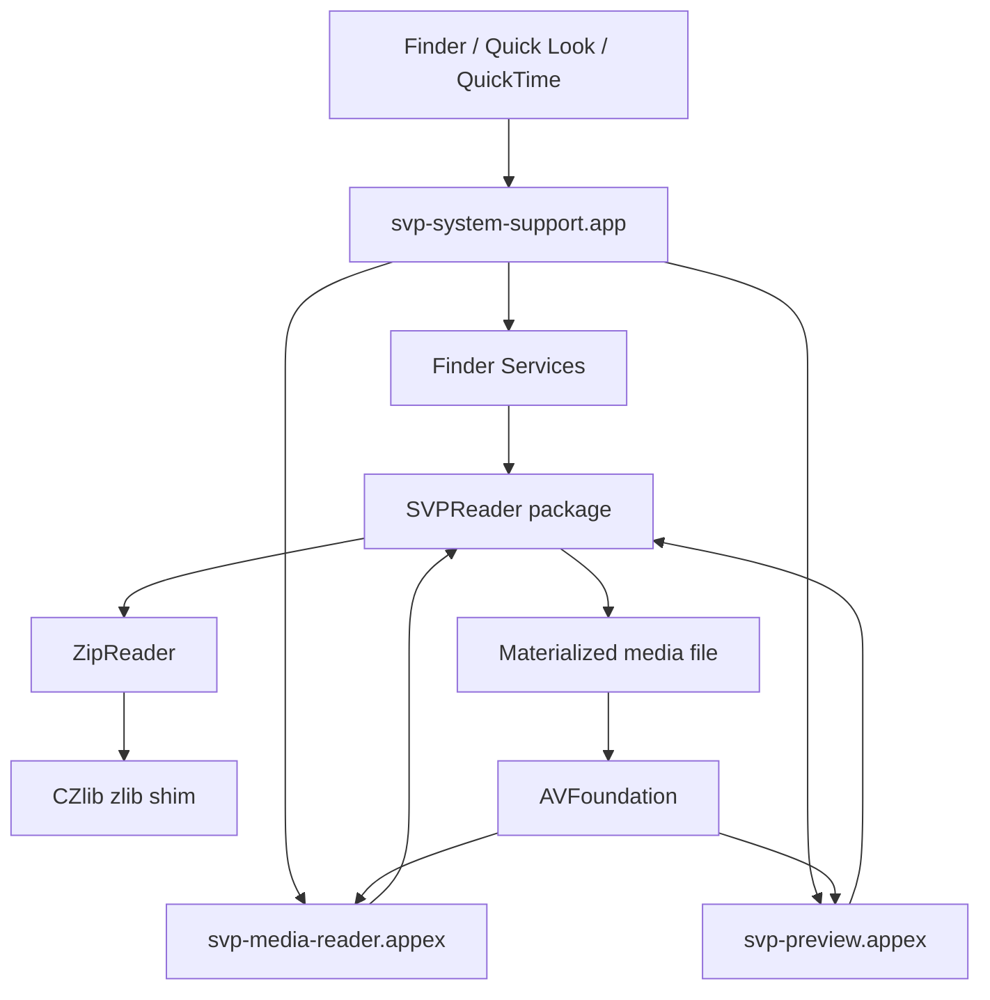

# SVP System Support

SVP System Support adds macOS support for Semantic Video Package (`.svp`) files. It registers the `.svp` file type, provides Quick Look previews, exposes SVP media through a MediaExtension format reader, and includes Finder services for extracting the embedded video or viewing transcript text.

The app itself is intentionally small. It mainly acts as the installed container for the system integrations, while the reusable SVP parsing work lives in the `SVPReader` Swift package.

## What This Repository Contains

| Path | Purpose |
| --- | --- |
| `svp-system-support/` | Host macOS app. Registers the SVP file type and provides Finder service actions. |
| `svp-preview/` | Quick Look preview extension for `.svp` files. |
| `svp-media-reader/` | MediaExtension format reader for system-level media access. |
| `SVPReader/` | Local Swift package that validates and reads SVP packages. |
| `scripts/postinstall` | Installer script that registers the app and extensions with Launch Services. |
| `build-pkg.sh` | Release packaging script that builds the app and creates a `.pkg` installer. |
| `VERIFICATION_REPORT.md` | Historical verification notes for the project. |

## Supported File Type

This project registers and handles:

| Property | Value |
| --- | --- |
| File extension | `.svp` |
| UTType | `com.semanticvideo.svp` |
| MIME type | `application/vnd.svp+zip` |
| Description | Semantic Video Package |

The app and MediaExtension declare this type in their `Info.plist` files.

## SVP Package Expectations

An SVP file is expected to be a ZIP-based package with at least:

```text
mimetype
manifest.json
media/original/<primary media file>
```

The `mimetype` entry must contain:

```text
application/vnd.svp+zip
```

`SVPReader` currently reads these manifest fields when present:

| Field | Meaning |
| --- | --- |
| `svp_version` | SVP format version string. |
| `package_id` | Package identifier. |
| `created_utc` | Package creation timestamp. |
| `primary_media_id` | Primary media identifier. |
| `timebase.unit` | Timebase unit. |
| `timebase.origin` | Timebase origin. |

Primary media is located by scanning `media/original/` for file entries. If there is exactly one media file, that file is used. If there are multiple files, the reader selects the first sorted entry and logs the selection.

Transcript text is read from:

```text
transcript/words.jsonl
```

Each JSON Lines record is expected to include a `text` value. The app joins those values into readable transcript text.

## Architecture



### `SVPReader`

`SVPReader` is the shared source of truth for reading SVP packages. It:

- Opens the SVP file as a ZIP archive.
- Validates the `mimetype` entry.
- Requires `manifest.json` to exist.
- Reads manifest metadata.
- Locates primary media in `media/original/`.
- Reads transcript words from `transcript/words.jsonl`.
- Materializes embedded media to a temporary directory when the system needs a real media file URL.
- Cleans up temporary media directories when asked.

The package avoids a libzip dependency. ZIP central directory parsing is implemented in Swift, and deflate decompression goes through the small `CZlib` C target linked against system zlib.

### Host App

The host app lives in `svp-system-support/`. It is an agent-style AppKit app with `LSUIElement` enabled, so it does not behave like a normal document editor.

It provides:

- File type registration for `.svp`.
- Finder service: `Extract Video from SVP`.
- Finder service: `Show SVP Transcript`.
- Open-file handling for `.svp` files.

When extracting video, the app asks the user where to save the embedded media file, writes it there, and reveals the result in Finder.

### Quick Look Extension

The Quick Look extension lives in `svp-preview/`.

It:

- Receives a `.svp` file from Quick Look.
- Validates the package with `SVPReader`.
- Materializes the primary media file.
- Returns a `QLPreviewReply` backed by the materialized media URL.

### MediaExtension Format Reader

The MediaExtension lives in `svp-media-reader/`.

It:

- Receives bytes from `MEByteSource`.
- Writes the source SVP to a temporary file.
- Validates and reads it through `SVPReader`.
- Extracts the primary media file to the same temporary working directory.
- Creates an `AVURLAsset` for the extracted media.
- Exposes file info, metadata, tracks, sample cursors, and sample buffers through MediaExtension protocols.

Sample cursor behavior is implemented in Objective-C in `SVPSampleCursorObjC.m` because the code needs to safely work with `AVAssetReader`, Core Media objects, and Objective-C exceptions from inside the MediaExtension runtime.

## Requirements

- macOS with Xcode support for the project targets.
- Swift 5.9 or newer for the `SVPReader` package.
- macOS 14 or newer for the Swift package.
- macOS 15.6 or newer for the MediaExtension target, based on the extension plist.
- Xcode command line tools.
- Apple signing/provisioning that supports the app and MediaExtension entitlements when testing installed system behavior.

## Build

Build the Swift package:

```bash
cd SVPReader
swift build
```

Build the app target:

```bash
xcodebuild \
  -project svp-system-support.xcodeproj \
  -scheme svp-system-support \
  -configuration Debug \
  build
```

Build the installer package:

```bash
./build-pkg.sh
```

The packaging script builds the Release configuration, stages the app under `build/pkg/Applications`, and writes:

```text
build/SVPSystemSupport.pkg
```

## Install

After building the package:

```bash
sudo installer -pkg build/SVPSystemSupport.pkg -target /
```

The post-install script registers:

- `/Applications/svp-system-support.app`
- `/Applications/svp-system-support.app/Contents/PlugIns/svp-preview.appex`
- `/Applications/svp-system-support.app/Contents/PlugIns/svp-media-reader.appex`

You may need to log out and back in before Finder, Quick Look, and MediaExtension fully pick up the new registrations.

## Verify Installation

Check that macOS recognizes an SVP file as the exported type:

```bash
mdls -name kMDItemContentType /path/to/file.svp
```

Expected content type:

```text
com.semanticvideo.svp
```

Stream project logs:

```bash
log stream --predicate 'subsystem == "com.cueit.svp-system-support"' --level debug
```

Useful log categories include:

| Category | Owner |
| --- | --- |
| `SVPReader` | Shared package reader. |
| `MediaExtension` | MediaExtension and sample cursor path. |

The host app also writes extraction logs to the app group container file named:

```text
svp_extract.log
```

## Test

Run the `SVPReader` package tests from the package directory:

```bash
cd SVPReader
swift test --scratch-path /tmp/SVPReader-test-clean
```

Important: the current package tests reference a local sample SVP file at:

```text
/Users/domesposito/Projects/svp/build/local-code-svp/CODE.svp
```

Those tests need that fixture to exist at that path unless the tests are updated to create or locate their own fixture.

The app and UI test targets currently contain default template tests.

## Creating a Minimal Local SVP Fixture

For manual testing, a minimal package can be assembled with a real media file:

```bash
mkdir -p /tmp/test-svp/media/original
printf 'application/vnd.svp+zip' > /tmp/test-svp/mimetype
printf '{"svp_version":"1.0","package_id":"test","primary_media_id":"media_000001"}' > /tmp/test-svp/manifest.json
cp /path/to/video.mov /tmp/test-svp/media/original/source_000.mov
cd /tmp/test-svp
zip -r /tmp/test.svp mimetype manifest.json media
```

## Finder Services

After installation, Finder can send `.svp` files to the app through macOS Services.

### Extract Video from SVP

This service:

1. Reads the selected `.svp` file.
2. Validates the package.
3. Locates the primary media file.
4. Opens a save panel with a default filename based on the SVP name and embedded media extension.
5. Writes the media file to the selected destination.
6. Reveals the extracted media in Finder.

### Show SVP Transcript

This service:

1. Reads the selected `.svp` file.
2. Validates the package.
3. Reads `transcript/words.jsonl`.
4. Displays joined transcript text in a simple macOS alert.

## Temporary Files

Quick Look and MediaExtension support both materialize embedded media to temporary directories because AVFoundation and system media APIs need normal file URLs for playback and sample extraction.

Temporary directories are named with prefixes such as:

```text
svp-media-
svp-me-
```

The reader exposes `cleanupMaterializedMedia(at:)`, and the extension paths clean up their temporary working directories when deinitialized.

## Troubleshooting

### `.svp` files do not show the expected type

Reinstall the package, then verify Launch Services registration:

```bash
mdls -name kMDItemContentType /path/to/file.svp
```

If the type still does not appear, log out and back in.

### Quick Look does not update after installing

Quick Look and Launch Services can cache extension state. Try logging out and back in after installing. Also confirm the app and extension bundles exist under `/Applications/svp-system-support.app/Contents/PlugIns/`.

### MediaExtension does not load

MediaExtension runtime behavior depends on signing, provisioning, entitlements, system version, and Launch Services registration. Confirm:

- The app is installed in `/Applications`.
- The MediaExtension appex exists inside the app bundle.
- The bundle is signed with the required MediaExtension entitlement.
- The system version supports the extension.
- Logs show activity under subsystem `com.cueit.svp-system-support`.

### Reader rejects a file as not SVP

Check that the package:

- Is a valid ZIP archive.
- Contains a `mimetype` entry.
- Has `application/vnd.svp+zip` as the mimetype content.
- Contains `manifest.json`.
- Contains at least one file under `media/original/`.

### Transcript display fails

The transcript service requires:

```text
transcript/words.jsonl
```

Each line should be valid JSON with a string `text` field.

## Maintenance Notes

- Keep SVP parsing behavior centralized in `SVPReader`.
- Keep file type declarations in sync between the host app and MediaExtension plists.
- Avoid duplicating package layout assumptions in app or extension code.
- Use the package reader for validation, manifest reads, transcript reads, and media materialization.
- Installer changes should be checked against both app bundle layout and Launch Services registration.
- MediaExtension changes should be verified with real installed builds, not only package tests.

## License

No license file is currently included in this repository.
